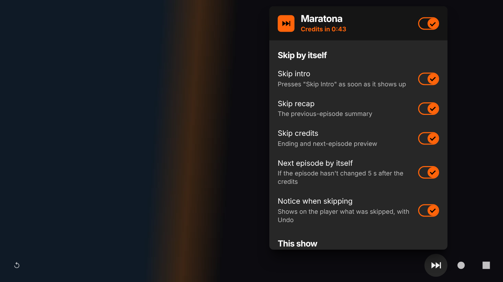
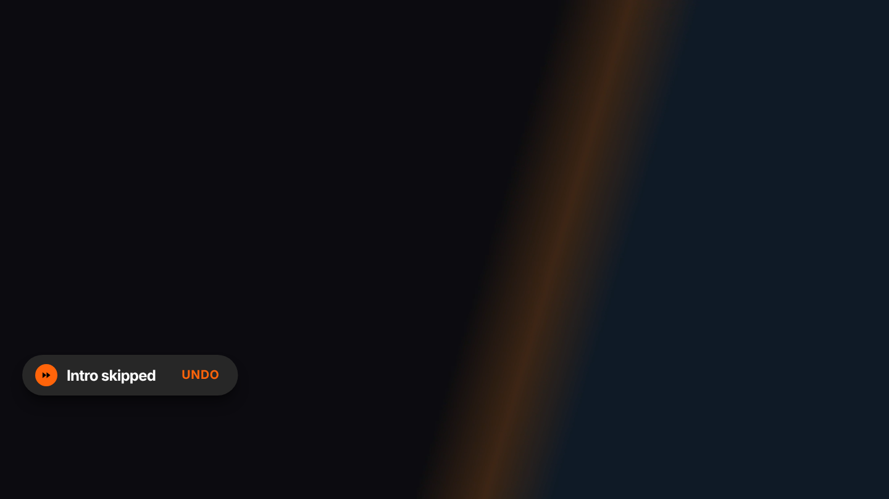
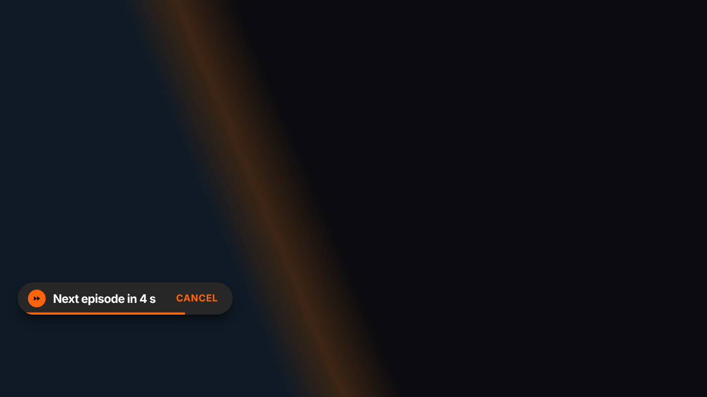
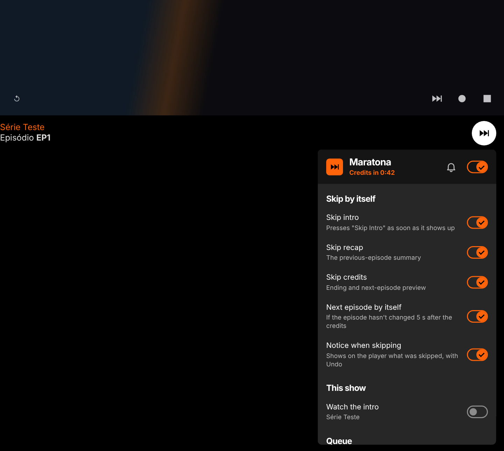
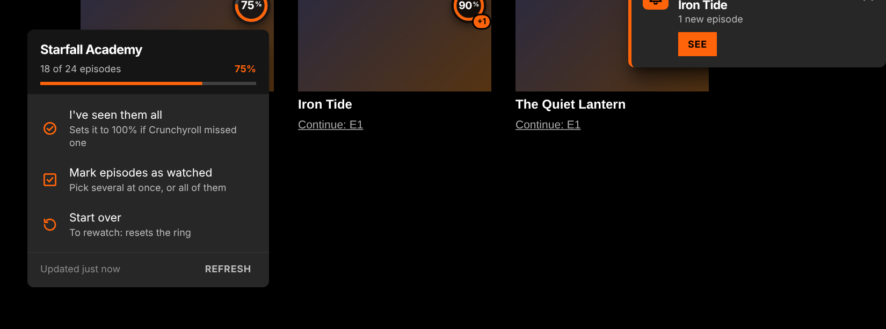
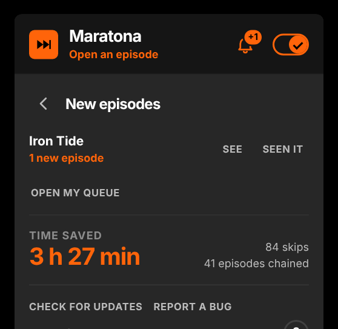
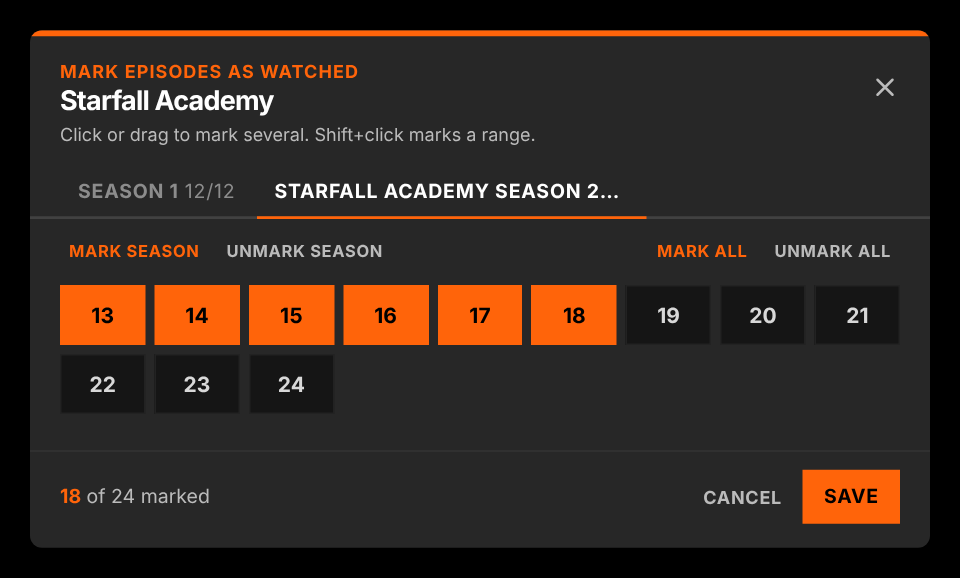
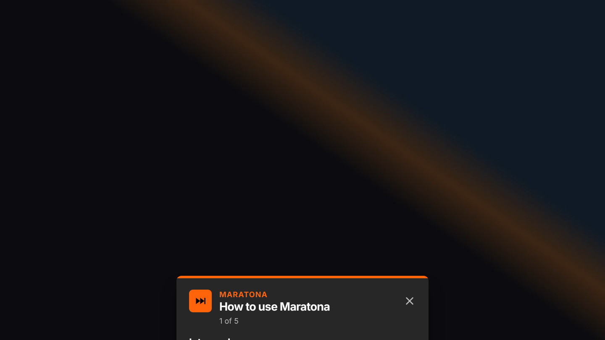
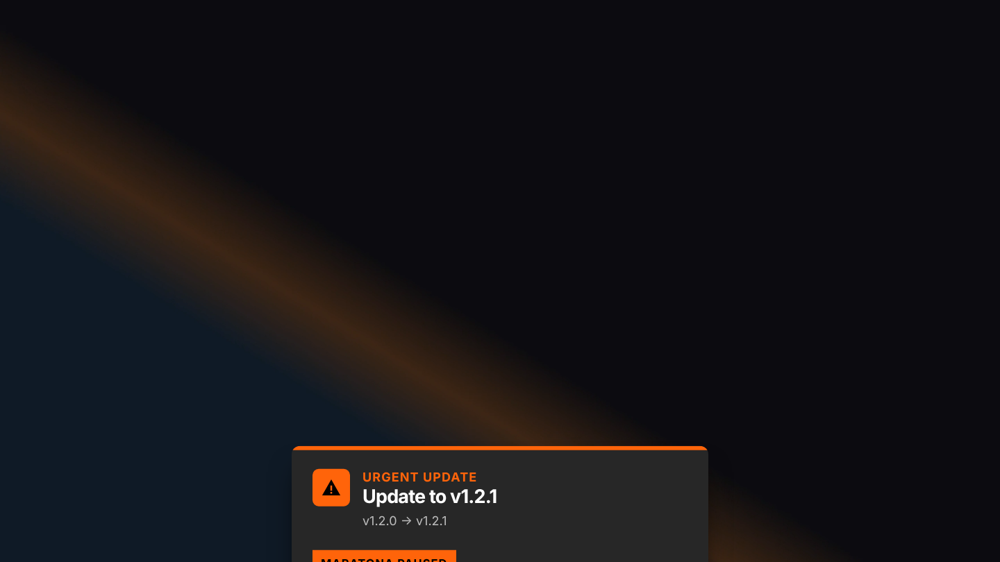

# Maratona

**Crunchyroll on autopilot.**
Presses Crunchyroll's own *Skip Intro*, *Skip Recap* and *Skip Credits* buttons the moment they show up, and moves on to the next episode when the player gets stuck at the end.

**Works on:** Chrome · Edge · Brave · Opera GX · Firefox 140+

---

## What it does

Nothing to set up: install it, open an episode and watch.

- **Intro and recap.** When the player's *Skip Intro* / *Skip Recap* button appears, Maratona presses it right away. It's the same button you'd click, so the player jumps exactly where Crunchyroll says the intro ends.
- **Credits and next episode.** It presses *Skip Credits*. If the episode hasn't changed 5 seconds later, it presses the player's own **Next episode** button.
  - Why: on the current web player, skipping the credits can leave the video paused on its very last frame, and autoplay never kicks in.
  - **Post-credit scenes are kept.** It only moves on if 10 seconds or less are left after skipping the credits. Otherwise it lets the scene play and moves on 5 seconds after it ends.
  - On the last episode of a season (no *Next episode* button) it does nothing.
- **It catches the button even when you didn't see it.** The player shows the skip button by itself for only about 5 seconds. If you open an episode in the middle of the intro, or the tab is in the background, Maratona briefly wakes the player controls (the same as moving the mouse over the video) and presses it.
- **Notice with Undo.** A small pill in the corner of the player says what was skipped, with **Undo** (it goes back using the player's own *Back 10 seconds* button and doesn't skip that part again in the episode). Before changing episodes there's a countdown with **Cancel**.
- **Your choice, per part, in a menu inside Crunchyroll.** Turn off intro, recap, credits, next episode or the notices, **watch the intro of one show you like** (Maratona remembers it per show), and see what's coming up (*Credits in 18:40*) and how much time you've saved.

&nbsp;&nbsp;

## The menu, inside Crunchyroll

Everything lives in one menu on the Crunchyroll page itself, and it never sits on top of the video:

- **In the player's control bar**, next to the gear, there's a Maratona button. It opens the menu right there, like the player's own *Settings* menu, and it's how you reach it in **fullscreen**. While it's open, the player controls stay visible; clicking in it never pauses the video.
- **Below the video**, an orange button sits right under the player (the menu opens downward, over the page, not over the video). In fullscreen it hides and comes back when you leave fullscreen. If there's no room under the player, it waits until you scroll.
- **On other Crunchyroll pages** it sits in a corner; drag it anywhere and it remembers the spot.
- **`Alt+M`** or the **toolbar icon** also open it.
- **Support ♥** at the bottom of the menu opens an optional box: in Brazil a Pix QR code (R$ 5, 10, 25 or any amount) with a copy button; elsewhere a link to GitHub Sponsors. It never opens by itself, needs no new permission and sends nothing.

## Progress in My Queue

In **My Lists → Queue**, every show gets a ring in the corner of its card with the **% of episodes you've watched**: everything Crunchyroll knows you finished, subbed or dubbed, in any season, OVA or movie it lists for that show.

- **Click the ring** for the details (*18 of 24 episodes*) and three actions:
  - **I've seen them all**: sets it to 100% in one click, for when Crunchyroll missed an episode you did watch (with *Undo*).
  - **Mark episodes as watched**: one tab per season, click an episode, **drag across several** or **Shift+click a range**, or mark a whole season or the whole show. Unmarking something Crunchyroll counted also works.
  - **Start over**: to rewatch a show from scratch. The ring goes back to 0% and only what you watch (or mark) from then on counts. *Count everything again* undoes it.
- **New episodes.** Maratona checks your queue by itself **every hour** while any Crunchyroll tab is open. When a show gets a new episode:
  - a small **pop-up** shows up in the corner of whatever Crunchyroll page you're on (once per episode), with *See*;
  - the Maratona button shows **+1, +2…** and the **bell** at the top of its menu lists the shows with new episodes (*See* opens the show, *Seen it* clears it);
  - its % drops and the ring in your queue **glows with +1**, and the toolbar icon shows **+1**.
  - It all clears when you open an episode of that show, press *Seen it* or *Ok*.
- **Nothing is written to your Crunchyroll account.** Your marks and restarts are kept by the extension (synced with your browser profile). The ring can be turned off in the menu (*Progress in My Queue*).

&nbsp;&nbsp;&nbsp;&nbsp;

## Looks like Crunchyroll

The interface uses the site's own design language, read from crunchyroll.com: the brand orange `#ff640a`, the `#272727` panels and switches from the player's *Settings* menu, the player's own button style in the control bar, uppercase buttons, the DM Sans typeface and the player's 0.2 s animations. It's an independent extension: no Crunchyroll logos, mascots or brand typefaces.

&nbsp;&nbsp;

## Install

### Chrome, Edge, Brave and Opera GX

1. Download **`maratona-vX.Y.Z.zip`** from the [latest release](https://github.com/DredsGG/maratona/releases/latest) and unzip it into a folder you'll keep.
2. Open `chrome://extensions` (Edge: `edge://extensions`, Brave: `brave://extensions`, Opera GX: `opera://extensions`).
3. Turn on **Developer mode** and click **Load unpacked**. Pick the folder.

Opera GX: if the extension disappears after you close the browser, load it again (a known Opera issue with unpacked extensions).

### Firefox 140+

1. Download **`maratona-vX.Y.Z.xpi`** from the [latest release](https://github.com/DredsGG/maratona/releases/latest) and confirm the install. If Firefox doesn't ask, use `about:addons` → gear icon → **Install Add-on From File**.
2. It updates itself.

No `.xpi` in the release yet? Use `about:debugging` → **This Firefox** → **Load Temporary Add-on** and pick `manifest.json` from the unzipped folder (it's removed when Firefox closes).

### Updating

Maratona checks this repository's releases by itself: when you open the browser, every 30 minutes, and whenever you come back to a Crunchyroll tab (at most once every 10 minutes). When there's a new version, a notice appears in the middle of the Crunchyroll page with what changed and an **Update** button.

- **Chrome, Edge, Brave, Opera GX:** *Update* downloads the new zip. Unzip it **over the same folder**; the extension notices within a minute and reloads itself, without reloading the episode you're watching.
- **Firefox:** *Update* opens the signed `.xpi`. Firefox also updates it on its own.
- The **✕** only postpones the notice for an hour. A release marked **URGENTE** (a fix for a serious problem) shows the notice without ✕, and Maratona pauses until you update.

## Languages

Everything is in **Portuguese, English and Spanish**: the menu, the queue rings and panels, notices, tutorial, *What's new* (also reachable from the menu footer), update notice and the install guide. The first time, it follows your browser's language (any other language falls back to English). Switch any time with **PT · EN · ES** in the menu footer or on any card; the choice is saved.

## How it works

- **Only Crunchyroll's own buttons.** Maratona never changes `video.currentTime`; on Crunchyroll's player that can leave the video loading forever. Skipping, undoing and going to the next episode all go through the player's buttons (`[data-testid="player-controls-root"]`, the skip button with `skip-intro-icon`, `next-episode-button`, `jump-backward-button`).
- **What kind of segment it is** comes from the same skip-events file the player uses (`static.crunchyroll.com/skip-events/production/<episode id>.json`), so it works whatever your profile language is. If that file is missing, it reads the button label, and as a last resort the position in the episode.
- **One small content script** on `www.crunchyroll.com` checks the player four times a second. Its interface (menu, notices, cards and the orange button) lives in a shadow DOM that follows the player into fullscreen and stops every click and key inside it from reaching the player. The control-bar button is a copy of the player's own gear button, put back automatically if the player redraws its bar. A background script (service worker on Chromium, event page on Firefox, same file) checks for updates and reloads the extension when a new version is unzipped over its folder.
- **Queue progress** uses the same requests the Crunchyroll website makes for you: a session token from your login cookie (`/auth/v1/token`, with the site's own client id and your browser's `device_id`), the show's seasons and episodes (`/content/v2/cms/...`) and your playheads (`/content/v2/<account>/playheads`, `fully_watched`) for every audio version. It only reads; results are cached so the ring shows up instantly and refreshes after 10 minutes.
- **Support box:** the Pix code (EMV with CRC16) is built locally in `src/apoio.js`; the QR code uses [qrcode-generator](https://www.npmjs.com/package/qrcode-generator) 1.4.4 (MIT, Kazuhiko Arase), unchanged, in `src/vendor/qrcode.js`.
- **Permissions:** `storage` (your settings, the shows whose intro you want to watch, the time-saved counter and the queue progress), `alarms` (update checks), `downloads` (the update zip) and `scripting` (to put a new version into tabs that are already open). Host access to `www.crunchyroll.com`, `static.crunchyroll.com` (skip-events) and `api.github.com` (latest release). **Nothing about you is collected or sent anywhere** (the queue requests go only to crunchyroll.com, as the site's own would). *Report a bug* opens a GitHub issue that you can read before sending: version, browser, settings and the last skips (type and seconds), never the shows or episodes you watched.

## Tests

- `tests/e2e.mjs`: Chromium with the real extension on a simulated Crunchyroll that copies the live player (same DOM, the skip button visible for only 5 s, the video stopping on its last frame). It covers intro, recap and credits, the 5 s rule, post-credit scenes, the last episode, waking the controls, Undo and Cancel, *What's new*, the update rules (a newer release showing up on an open page, ✕ postponing for an hour, URGENTE pausing everything) and the menu (control-bar button in the same row as the gear, orange button docked under the video, live status, per-show intro, `Alt+M`, toolbar icon, fullscreen with clicks that don't pause the video, dragging and remembering the button), all in PT, EN and with an unknown label language. Setup in [`tests/README.md`](tests/README.md).
- `tests/fila-e2e.mjs`: the queue on a simulated *My Lists → Queue* and Crunchyroll API in the format measured live (token, seasons, episodes, playheads in batches of 50): the right % with subbed and dubbed views, clips and unreleased episodes left out, clicking the ring without opening the show, drag and Shift+click, unmarking, *I've seen them all* with Undo, start over / rewatch / count everything again, a new episode (glow, +1 on the ring and the icon, the menu entry, cleared by opening an episode), cache on reload, the virtual list redrawing cards, the on/off switch, EN and ES, the hourly check from another page, the new-episode pop-up (shown once), the +1 on the Maratona button, the bell list with *Seen it*, and *What's new* (shown again until you close it).
- `tests/apoio-e2e.mjs`: the Support box. The Pix codes match the reference ones character by character, the QR code is read back from the image and matches, copy, GitHub Sponsors in a new tab, Back, Esc, click outside, focus trap, PT/EN/ES and no network request while it's open.
- **Firefox** (GitHub Actions, `Test` workflow): `web-ext lint` with no errors, then real Firefox with the extension installed: tutorial, intro skipped with the notice, credits → next episode in about 5 s, a post-credit scene left playing, the menu (control-bar button, orange button under the video, menu opening on click) and the queue rings (the API requests go through Firefox's `content.fetch`).

The screenshots on this page are the real extension running on that simulated player, with a generated video.

## Support

This project is free and always will be. If it helps you, you can support it on [GitHub Sponsors](https://github.com/sponsors/DredsGG) (one-time or monthly). 🇧🇷 In Brazil? Pix: `fa525dad-afca-4683-845d-eee7225a53e3`

## Disclaimer

Personal project, not affiliated with or endorsed by Crunchyroll. It only presses buttons the Crunchyroll player already offers you; it doesn't download, record or change any video. Crunchyroll's web player changes often, so a feature can stop working until the extension is updated (use *Report a bug*).

## License

[MIT](LICENSE) · DM Sans typeface under the [SIL Open Font License](extension/fonts/OFL.txt) · made by [André Miller Fleck (Dreds)](https://github.com/DredsGG)
