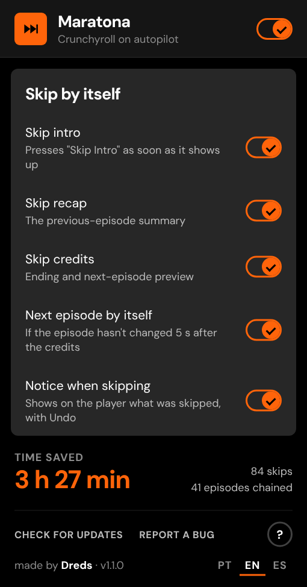

# Maratona

**Crunchyroll on autopilot.**
Presses Crunchyroll's own *Skip Intro*, *Skip Recap* and *Skip Credits* buttons the moment they show up, and moves on to the next episode when the player gets stuck at the end.

**Works on:** Chrome · Edge · Brave · Opera GX · Firefox 140+

&nbsp;&nbsp;

---

## What it does

Nothing to set up: install it, open an episode and watch.

- **Intro and recap.** When the player's *Skip Intro* / *Skip Recap* button appears, Maratona presses it right away. It's the same button you'd click, so the player jumps exactly where Crunchyroll says the intro ends.
- **Credits and next episode.** It presses *Skip Credits*. If the episode hasn't changed 5 seconds later, it presses the player's own **Next episode** button.
  - Why: on the current web player, skipping the credits can leave the video paused on its very last frame, and autoplay never kicks in.
  - **Post-credit scenes are kept.** It only moves on if 10 seconds or less are left after skipping the credits. Otherwise it lets the scene play and moves on 5 seconds after it ends.
  - On the last episode of a season (no *Next episode* button) it does nothing.
- **It catches the button even when you didn't see it.** The player shows the skip button by itself for only about 5 seconds. If you open an episode in the middle of the intro, or the tab is in the background, Maratona briefly wakes the player controls (the same as moving the mouse over the video) and presses it.
- **Notice with Undo.** A small pill in the corner of the player says what was skipped, with **Undo** (it goes back using the player's own *Back 10 seconds* button and doesn't skip that part again in the episode). Before changing episodes there's a countdown with **Cancel**.
- **Your choice, per part.** The toolbar icon opens a popup to turn off intro, recap, credits, next episode or the notices, and shows how much time you've saved.

## Looks like Crunchyroll

The interface uses the site's own design language, read from crunchyroll.com: the brand orange `#ff640a`, the `#272727` panels and switches from the player's *Settings* menu, uppercase buttons, the DM Sans typeface and the player's 0.2 s animations. It's an independent extension: no Crunchyroll logos, mascots or brand typefaces.

&nbsp;&nbsp;

## Install

### Chrome, Edge, Brave and Opera GX

1. Download **`maratona-vX.Y.Z.zip`** from the [latest release](https://github.com/DredsGG/maratona/releases/latest) and unzip it into a folder you'll keep.
2. Open `chrome://extensions` (Edge: `edge://extensions`, Brave: `brave://extensions`, Opera GX: `opera://extensions`).
3. Turn on **Developer mode** and click **Load unpacked**. Pick the folder.

Opera GX: if the extension disappears after you close the browser, load it again (a known Opera issue with unpacked extensions).

### Firefox 140+

1. Download **`maratona-vX.Y.Z.xpi`** from the [latest release](https://github.com/DredsGG/maratona/releases/latest) and confirm the install. If Firefox doesn't ask, use `about:addons` → gear icon → **Install Add-on From File**.
2. It updates itself.

No `.xpi` in the release yet? Use `about:debugging` → **This Firefox** → **Load Temporary Add-on** and pick `manifest.json` from the unzipped folder (it's removed when Firefox closes).

### Updating

Maratona checks this repository's releases by itself: when you open the browser, every 30 minutes, and whenever you come back to a Crunchyroll tab (at most once every 10 minutes). When there's a new version, a notice appears in the middle of the Crunchyroll page with what changed and an **Update** button.

- **Chrome, Edge, Brave, Opera GX:** *Update* downloads the new zip. Unzip it **over the same folder**; the extension notices within a minute and reloads itself, without reloading the episode you're watching.
- **Firefox:** *Update* opens the signed `.xpi`. Firefox also updates it on its own.
- The **✕** only postpones the notice for an hour. A release marked **URGENTE** (a fix for a serious problem) shows the notice without ✕, and Maratona pauses until you update.

## Languages

Everything is in **Portuguese, English and Spanish**: popup, notices, tutorial, *What's new*, update notice and the install guide. The first time, it follows your browser's language (any other language falls back to English). Switch any time with **PT · EN · ES** in the popup footer or on any card; the choice is saved.

## How it works

- **Only Crunchyroll's own buttons.** Maratona never changes `video.currentTime`; on Crunchyroll's player that can leave the video loading forever. Skipping, undoing and going to the next episode all go through the player's buttons (`[data-testid="player-controls-root"]`, the skip button with `skip-intro-icon`, `next-episode-button`, `jump-backward-button`).
- **What kind of segment it is** comes from the same skip-events file the player uses (`static.crunchyroll.com/skip-events/production/<episode id>.json`), so it works whatever your profile language is. If that file is missing, it reads the button label, and as a last resort the position in the episode.
- **One small content script** on `www.crunchyroll.com` checks the player four times a second. Its interface lives in a shadow DOM that follows the player into fullscreen. A background script (service worker on Chromium, event page on Firefox, same file) checks for updates and reloads the extension when a new version is unzipped over its folder.
- **Permissions:** `storage` (your settings and the time-saved counter), `alarms` (update checks), `downloads` (the update zip) and `scripting` (to put a new version into tabs that are already open). Host access to `www.crunchyroll.com`, `static.crunchyroll.com` (skip-events) and `api.github.com` (latest release). **Nothing about you is collected or sent anywhere.** *Report a bug* opens a GitHub issue that you can read before sending: version, browser, settings and the last skips (type and seconds), never the shows or episodes you watched.

## Tests

- `tests/e2e.mjs`: Chromium with the real extension on a simulated Crunchyroll that copies the live player (same DOM, the skip button visible for only 5 s, the video stopping on its last frame). It covers intro, recap and credits, the 5 s rule, post-credit scenes, the last episode, waking the controls, Undo and Cancel, switches, *What's new* and the update rules (a newer release showing up on an open page, ✕ postponing for an hour, URGENTE pausing everything), all in PT, EN and with an unknown label language. Setup in [`tests/README.md`](tests/README.md).
- **Firefox** (GitHub Actions, `Test` workflow): `web-ext lint` with no errors, then real Firefox with the extension installed: tutorial, intro skipped with the notice, credits → next episode in about 5 s, and a post-credit scene left playing.

The screenshots on this page are the real extension running on that simulated player, with a generated video.

## Disclaimer

Personal project, not affiliated with or endorsed by Crunchyroll. It only presses buttons the Crunchyroll player already offers you; it doesn't download, record or change any video. Crunchyroll's web player changes often, so a feature can stop working until the extension is updated (use *Report a bug*).

## License

[MIT](LICENSE) · DM Sans typeface under the [SIL Open Font License](extension/fonts/OFL.txt) · made by [André Miller Fleck (Dreds)](https://github.com/DredsGG)
